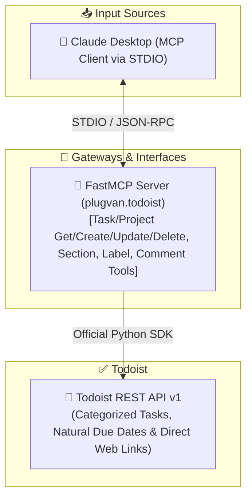

# Plugvan

<p align="center">
  <a href="https://github.com/kagankurubas/plugvan/actions/workflows/ci.yml"></a>
  
  
  
  
  
</p>

<p align="center">
  <strong>Plugvan: hand-written and validated MCP integrations for the apps you use, starting with Todoist. It is a standalone server, not a gateway or proxy for other MCP servers.</strong>
</p>

<p align="center">
  <strong>Todoist integration:</strong> A local Model Context Protocol (MCP) server that lets AI assistants like Claude Desktop manage Todoist over STDIO, with smart project routing, natural language due dates, and strict validation.
</p>

<p align="center">
  <a href="#english">English</a> •
  <a href="#türkçe">Türkçe</a> •
  <a href="#architecture">Architecture</a> •
  <a href="#tests">Tests</a>
</p>

---

<a name="architecture"></a>
## 🏗️ Architecture & Data Flow / Mimari Akış



---

<a name="english"></a>
## 🇬🇧 English

Plugvan is primarily a local **Model Context Protocol (MCP)** server: Claude Desktop launches it as a subprocess and talks to it over STDIO, so no web server or deployment is needed. It lets an AI assistant manage Todoist through conversation using smart project resolution, natural language due dates, and strict schema validation.

### 🌟 Key Features

- **🤖 Model Context Protocol (MCP) Server (`plugvan.todoist`):** FastMCP server over STDIO for Claude Desktop with full suite of Todoist management tools:
  - **Tasks:** `create_task` (subtasks via `parent_id`, deadlines via `deadline_date`), `get_task`, `list_tasks`, `complete_task`, `reopen_task`, `update_task` (move/reparent, deadline updates), `delete_task`
  - **Sections / Kanban:** `create_section`, `list_sections`, `update_section`, `delete_section`
  - **Labels:** `list_labels`, `create_label`, `update_label`, `delete_label`
  - **Comments / Notes:** `add_comment`, `get_comments`
  - **Projects & Hierarchy:** `create_project` (nested subprojects), `get_project`, `update_project`, `delete_project`, `list_projects` (tree view)
- **🎯 Smart Name Resolution:** Maps human-readable project, section and label names (case-insensitive, with Turkish/Unicode normalization) to Todoist IDs.
  - **MCP tools:**
    - An unknown name returns an error, and nothing is written.
    - When several items match, the tool returns an ambiguity error listing up to 5 candidates as `name (ID)`.
    - Destructive tools (`delete_project`, `update_project`, `delete_section`, `update_section`, `delete_label`, `update_label`) accept only an ID or an exact name.
    - `create_task`, `update_task`, `create_project` (parent), `create_section` and `list_sections` also accept a project name that partially matches exactly one project. Their messages show the project's real name.
    - Sections match only by ID or exact name, inside the resolved project.
    - `Inbox` / `Gelen Kutusu` always resolve to the Inbox.
- **📏 Name limits (MCP tools):**
  - Project names: up to 120 characters.
  - Label names: up to 60 characters.
  - Section names: up to 120 characters here. Todoist allows 2,048 (as of October 2026), so a section with a longer name can only be addressed by its ID.
  - The number of projects you can have depends on your Todoist plan. See Todoist's official [Usage limits in Todoist](https://www.todoist.com/help/todoist/get-started/usage-limits-in-todoist-e5rcSY) page for the current limits.
  - Name lookup searches only your active projects.
  - Archived projects are not listed, so their names are reported as "not found".

### 📁 Project Structure

```text
plugvan/
├── plugvan/todoist/        # FastMCP server for Claude Desktop (STDIO, python -m plugvan.todoist)
├── tests/                  # Pytest test suite (unit & integration tests)
├── pyproject.toml          # Package metadata and dependencies
└── .env.example            # Environment variable template
```

---

### 🚀 Getting Started

#### 1. Clone the Repository
```bash
git clone https://github.com/kagankurubas/plugvan.git
cd plugvan
```

#### 2. Create Virtual Environment & Install Dependencies
```bash
# Create virtual environment
python -m venv venv

# Activate virtual environment
# Windows (PowerShell):
.\venv\Scripts\activate
# macOS / Linux:
source venv/bin/activate

# Install required packages
pip install -e ".[test]"
```

#### 3. Configure Environment Variables
Copy `.env.example` to `.env`:
```bash
cp .env.example .env
```

Edit your `.env` file with your own credentials:
```env
TODOIST_API_TOKEN=your_todoist_api_token_here
# Optional: PLUGVAN_LANG=tr
```

**How to obtain your credentials:**
- **`TODOIST_API_TOKEN`**: Log into [Todoist Web](https://todoist.com) ➔ Settings ➔ **Integrations** ➔ **Developer** ➔ Copy your API token.
- **`PLUGVAN_LANG`** (optional): the language of tool results, `en` (default) or `tr` for Turkish.

> [!CAUTION]
> **🔒 Security Considerations:**
> - **Secret Management:** Keep `.env` private. It is pre-configured in `.gitignore` and must never be committed to Git.

---

### 🛠️ Usage Methods

#### Method 1: Claude Desktop (Model Context Protocol - MCP)
Integrate Todoist directly into your Claude Desktop application.

1. Open `%APPDATA%\Claude\claude_desktop_config.json` (or **Settings ➔ Developer ➔ Edit Config** in Claude Desktop).
2. Add the `todoist` server configuration (replace `<REPO_PATH>` with your project path):
```json
{
  "mcpServers": {
    "todoist": {
      "command": "<REPO_PATH>\\venv\\Scripts\\python.exe",
      "args": ["-m", "plugvan.todoist"],
      "env": {
        "PYTHONPATH": "<REPO_PATH>",
        "PYTHONIOENCODING": "utf-8"
      }
    }
  }
}
```
   For Turkish tool results, add `"PLUGVAN_LANG": "tr"` to the `env` block.
3. Restart Claude Desktop. You can now prompt Claude:
   - *"List my open tasks in Todoist for today."*
   - *"Create a p2 task 'Prepare weekly report' due tomorrow at 14:00."*
   - *"Complete task ID 6hM2..."*

---

<a name="türkçe"></a>
## 🇹🇷 Türkçe

Plugvan, temelde yerel çalışan bir **Model Context Protocol (MCP)** sunucusudur: Claude Desktop onu alt süreç olarak başlatır ve STDIO üzerinden konuşur; web sunucusu veya deploy gerekmez. Yapay zeka asistanının Todoist'i sohbet üzerinden yönetmesini sağlar.

### 🌟 Öne Çıkan Özellikler

- **🤖 Model Context Protocol (MCP) Sunucusu (`plugvan.todoist`):** Claude Desktop için FastMCP mimarisiyle yerel STDIO üzerinden çalışan kapsamlı Todoist yönetim araç seti:
  - **Görev Yönetimi:** `create_task` (parent_id ile alt görev, deadline_date ile son teslim tarihi), `get_task`, `list_tasks`, `complete_task`, `reopen_task`, `update_task` (proje/bölüm/üst görev taşıma, deadline güncelleme), `delete_task`
  - **Bölüm / Kanban Listeleri:** `create_section`, `list_sections`, `update_section`, `delete_section`
  - **Etiketler:** `list_labels`, `create_label`, `update_label`, `delete_label`
  - **Yorumlar & Notlar:** `add_comment`, `get_comments`
  - **Projeler & Hiyerarşi:** `create_project` (alt proje / parent_id), `get_project`, `update_project`, `delete_project`, `list_projects` (ağaç görünümü)
- **🎯 Akıllı İsim Eşleme:** Proje, bölüm ve etiket isimlerini büyük/küçük harf duyarsız ve Türkçe karakter uyumlu olarak Todoist ID'lerine eşler.
  - **MCP tool'ları:**
    - Bilinmeyen isim hata döndürür ve hiçbir şey yazılmaz.
    - Birden fazla eşleşmede en fazla 5 aday `isim (ID)` olarak listelenir.
    - Yıkıcı tool'lar (`delete_project`, `update_project`, `delete_section`, `update_section`, `delete_label`, `update_label`) yalnızca ID veya tam isim kabul eder.
    - `create_task`, `update_task`, `create_project` (üst proje), `create_section` ve `list_sections` yalnızca tek bir projeyle kısmi eşleşen bir proje adını da kabul eder; mesajlar projenin gerçek adını gösterir.
    - Bölümler yalnızca ID veya tam isimle, çözümlenen projenin içinde aranır.
    - `Inbox` / `Gelen Kutusu` her zaman Gelen Kutusu'na çözümlenir.
- **📏 İsim limitleri (MCP tool'ları):**
  - Proje adı: en fazla 120 karakter.
  - Etiket adı: en fazla 60 karakter.
  - Bölüm adı: burada en fazla 120 karakter. Todoist 2.048 karaktere izin verdiği için (Ekim 2026 itibarıyla) daha uzun isimli bir bölüme yalnızca ID ile ulaşılabilir.
  - Kullanabileceğiniz proje sayısı Todoist planınıza göre değişir. Güncel limitler için Todoist'in resmi [Usage limits in Todoist](https://www.todoist.com/help/todoist/get-started/usage-limits-in-todoist-e5rcSY) sayfasına bakın.
  - İsim araması yalnızca aktif projeleriniz içinde yapılır.
  - Arşivlenmiş projeler listelenmediği için isimleri "bulunamadı" sayılır.

### 📁 Proje Yapısı

```text
plugvan/
├── plugvan/todoist/        # Claude Desktop için FastMCP sunucusu (STDIO, python -m plugvan.todoist)
├── tests/                  # Pytest test paketi (birim ve entegrasyon testleri)
├── pyproject.toml          # Paket bilgileri ve bağımlılıklar
└── .env.example            # Çevre değişkeni şablonu
```

---

### 🚀 Kurulum ve Başlangıç

#### 1. Projeyi Klonlayın
```bash
git clone https://github.com/kagankurubas/plugvan.git
cd plugvan
```

#### 2. Sanal Ortam Oluşturun ve Paketleri Yükleyin
```bash
python -m venv venv

# Windows (PowerShell):
.\venv\Scripts\activate
# macOS / Linux:
source venv/bin/activate

pip install -e ".[test]"
```

#### 3. Çevre Değişkenlerini Yapılandırın
`.env.example` dosyasını `.env` olarak kopyalayın:
```bash
cp .env.example .env
```

`.env` dosyanızı açıp kendi token ve anahtarlarınızı girin:
```env
TODOIST_API_TOKEN=kendi_todoist_api_tokeniniz
# İsteğe bağlı: PLUGVAN_LANG=tr
```

**Anahtarlarınızı Alma:**
- **`TODOIST_API_TOKEN`**: [Todoist Web](https://todoist.com) ➔ Ayarlar ➔ **Entegrasyonlar** ➔ **Geliştirici** ➔ API belirtecinizi kopyalayın.
- **`PLUGVAN_LANG`** (isteğe bağlı): araç sonuçlarının dili; `en` (varsayılan) veya Türkçe için `tr`.

> [!CAUTION]
> **🔒 Güvenlik Uyarıları:**
> - **Gizli Anahtar Yönetimi:** `.env` dosyası `.gitignore`'da tanımlıdır; bu dosyayı asla Git deposuna eklemeyin ve kimseyle paylaşmayın.

---

### 🛠️ Kullanım Yöntemleri

#### 1. Yöntem: Claude Desktop ile Kullanım (MCP Sunucusu)
Claude Desktop uygulamanıza Todoist yeteneği kazandırmak için:

1. `%APPDATA%\Claude\claude_desktop_config.json` dosyasını açın (veya Claude Desktop ➔ **Settings ➔ Developer ➔ Edit Config**).
2. Aşağıdaki yapılandırmayı ekleyin (`<REPO_PATH>` yerine kendi proje yolunuzu yazın):
```json
{
  "mcpServers": {
    "todoist": {
      "command": "<REPO_PATH>\\venv\\Scripts\\python.exe",
      "args": ["-m", "plugvan.todoist"],
      "env": {
        "PYTHONPATH": "<REPO_PATH>",
        "PYTHONIOENCODING": "utf-8"
      }
    }
  }
}
```
   Araç sonuçlarını Türkçe almak için `env` bloğuna `"PLUGVAN_LANG": "tr"` ekleyin.
3. Claude Desktop'ı tamamen kapatıp yeniden başlatın. Artık Claude ile sohbet ederken doğrudan Todoist'e görev ekleyebilir, görevlerinizi listeleyebilir veya tamamlayabilirsiniz:
   - *"Bugün için tanımlı Todoist görevlerimi listele."*
   - *"Yarın saat 15:00'e 'Proje Raporunu Teslim Et' başlıklı p2 görev ekle."*
   - *"ID'si 6hM2... olan görevi kapat."*

---

<a name="tests"></a>
## 🧪 Testing / Testleri Çalıştırma

Projede birim ve entegrasyon testleri yer almaktadır:

```bash
# Tüm testleri çalıştırmak için:
pytest

# Detaylı çıktı ile çalıştırmak için:
pytest -v
```

---

## 📄 License / Lisans

This project is licensed under the [MIT License](LICENSE).  
Bu proje [MIT Lisansı](LICENSE) kapsamında lisanslanmıştır.
